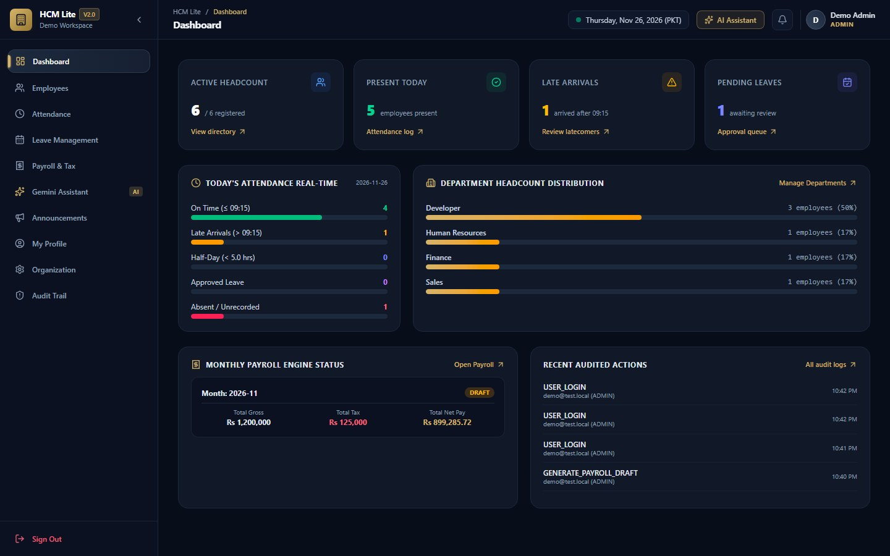
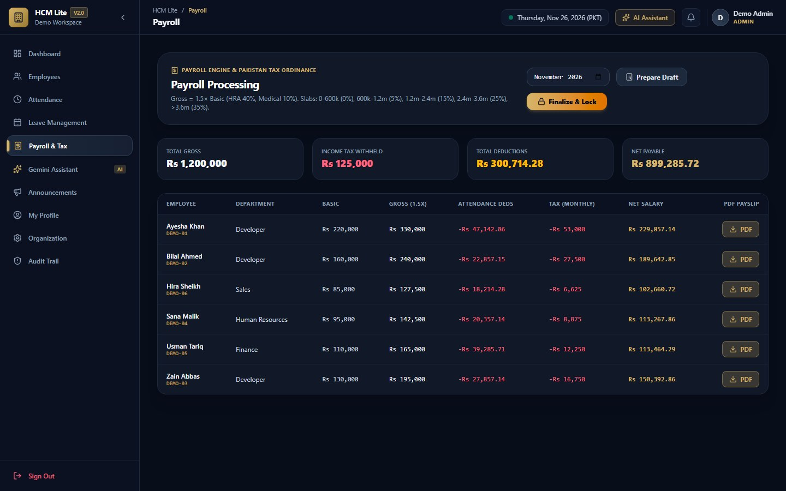
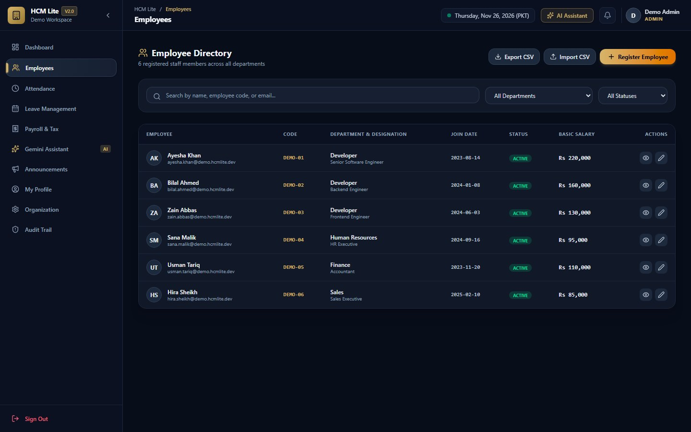
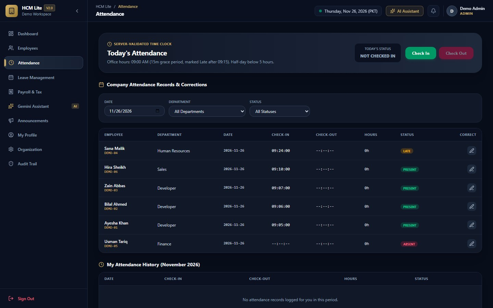
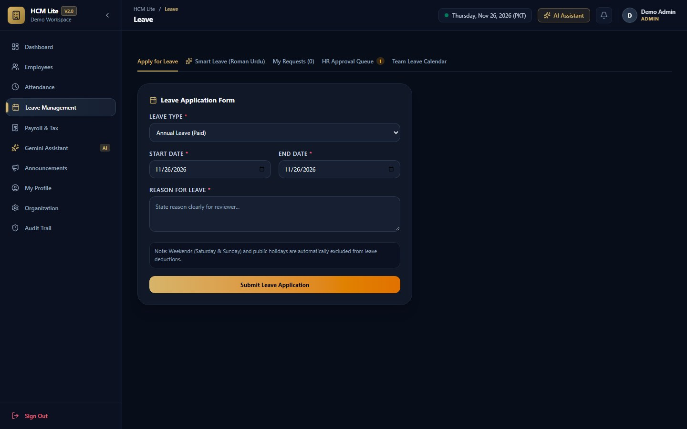
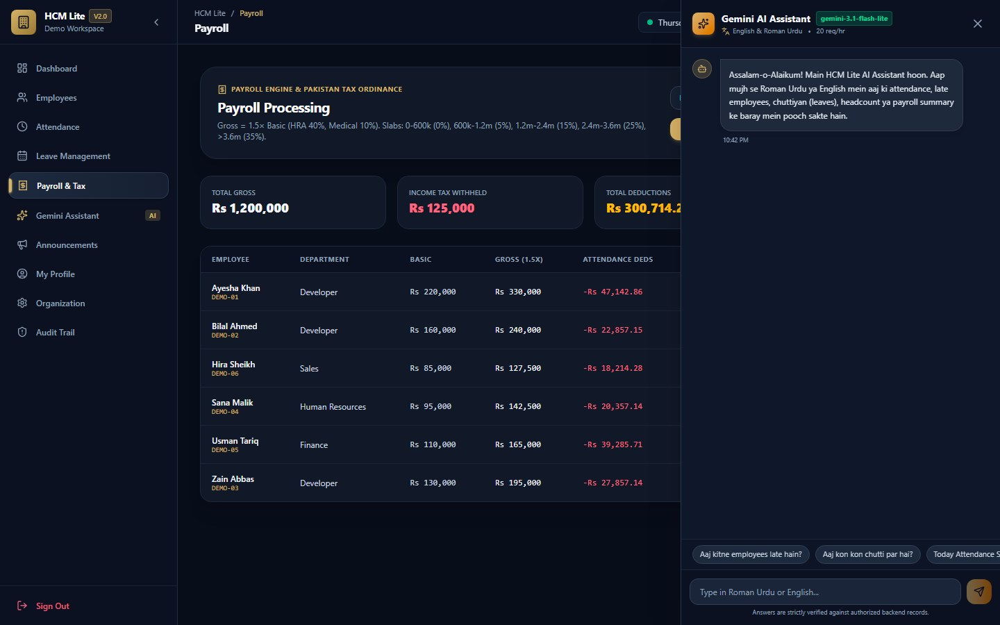

# HCM Lite — Human Capital Management System

**Saylani Hackathon · Full-Stack Submission**

[](https://hacathon-test.vercel.app)
[](https://github.com/ahmedali786166/hacathon-test-)
[](https://react.dev)
[](https://www.typescriptlang.org)
[](https://expressjs.com)
[](https://turso.tech)

A complete, production-style HR platform for small teams: employee directory, attendance, leave workflows, Pakistan income-tax payroll with PDF payslips, audit trails, role-based permissions, and a Gemini AI assistant that speaks **English and Roman Urdu**.



---

## 🚀 Try the live demo (60 seconds)

1. Open **[hacathon-test.vercel.app](https://hacathon-test.vercel.app)**.
2. Click **“New here? Sign Up & Create Your Company”** and complete the wizard. The email and password you enter become your admin login (the wizard is re-runnable, so every evaluator can create their own workspace).
3. On the dashboard, click **“Load sample workspace”** in the *Evaluating HCM Lite?* banner. This adds 6 employees, month-to-date attendance, leave requests/balances and an announcement — one click, fully removable.
4. Walk the flow:
   - **Employees** → search, CSV import, register a new employee, create their login.
   - **Attendance** → punch in/out, corrections with a mandatory audit reason.
   - **Leave Management** → pending requests, approve/reject, calendar, smart leave parsing.
   - **Payroll & Tax** → **Prepare Draft** for the current month, review tax/deductions, download a PDF payslip, then **Finalize & Lock** as Admin.
   - **Gemini Assistant** → try the Roman Urdu prompt chips at the bottom of the drawer.
5. The sample data can be removed any time with `DELETE /api/demo/reset` (admin only).

> Tip for judges: after loading the sample workspace, open **Payroll & Tax → Prepare Draft**. The engine computes gross, HRA, medical allowance, attendance deductions and Pakistan tax slabs for all six employees instantly.

---

## 📸 Screenshots

| Dashboard | Payroll & Tax |
| --- | --- |
|  |  |

| Employees | Attendance |
| --- | --- |
|  |  |

| Leave Management | Gemini AI Assistant |
| --- | --- |
|  |  |

---

## ✨ Why this is more than a CRUD demo

- **Real relational database** — libSQL/Turso in production with foreign keys, unique constraints, cascades and transactions. No mock arrays, no localStorage business data.
- **A real payroll engine** — Pakistan income-tax slabs, 1.5× gross structure, HRA/medical split, working-day denominators, absence/half-day deductions, month locking and PDF payslips.
- **AI that queries the database safely** — Gemini uses server-side tool calling; every answer comes from authorized SQL, not invented numbers. Salary is masked for users without payroll rights.
- **Server-enforced RBAC** — Admin / HR / Employee permissions are validated on every route, not just hidden in the UI.
- **Audit trail everywhere** — logins, payroll generation/locking, attendance corrections, employee changes and demo seeding are recorded with actor, role, IP and before/after state.
- **One-click demo dataset** — evaluators see a populated product immediately, without touching SQL.

---

## 🧩 Feature tour

### 1. Authentication & onboarding
- First-run setup wizard creates company settings, office rules, standard leave types and the first Admin account.
- JWT sessions in HTTP-only cookies (with Bearer-token support for API clients), bcrypt password hashing, active-user checks on every request.
- Change-password flow under **My Profile**; secure re-run of the setup wizard to update admin credentials.

### 2. Dashboard & analytics
- Live headcount, present/late/absent/half-day/on-leave counts, pending leave queue.
- Department headcount distribution, month-to-date payroll status, recent audited actions, announcements feed.
- Role-aware: employees get a personal dashboard with punch clock, leave balances and payslips.

### 3. Employee management
- Searchable directory with department/designation joins, salary visibility rules.
- Register employees, edit details, activate/deactivate, create employee login accounts.
- CSV import with validation preview and partial-failure reporting.
- 360° employee drawer (profile, attendance, leave, payroll history).

### 4. Attendance
- Check-in/check-out with configurable office start time, grace period and half-day threshold (Asia/Karachi timezone).
- Status derivation: PRESENT, LATE, HALF_DAY, ABSENT, ON_LEAVE, WEEKEND, HOLIDAY.
- HR/Admin corrections require a reason and are written to both `attendance_corrections` and the audit log.
- Filters by date range, status and employee; personal history for employees.

### 5. Leave management
- Annual, Sick, Casual and Unpaid leave types with per-employee yearly balances.
- Apply, cancel, approve/reject queue with reviewer comments and pending/used balance accounting.
- Team leave calendar and holiday list.
- **Smart Leave Assistant**: parses free-text Roman Urdu/English (“Mujhe aglay Monday se do din ki sick leave chahiye”), checks balance, and pre-fills the application for explicit employee confirmation.

### 6. Payroll & tax (Pakistan)
- Gross = 1.5 × Basic; HRA = 40% of Basic; Medical = 10% of Basic.
- Daily gross = Gross ÷ working days in month (weekends and holidays excluded).
- Absent deduction = absent days × daily gross; half-day deduction = 0.5 × daily gross × half-days.
- Annual tax slabs: 0% ≤ 600k; 5% 600k–1.2m; 30k + 15% 1.2m–2.4m; 210k + 25% 2.4m–3.6m; 510k + 35% above 3.6m. Monthly tax = annual ÷ 12.
- Mid-month drafts only count **elapsed** working days, so future dates are never deducted as absent.
- HR prepares drafts; **only Admin can Finalize & Lock**. Locked months cannot be recalculated.
- Computer-generated PDF payslips (jsPDF) in PKR with company and employee details.

### 7. Gemini AI assistant
- Server-side integration via `@google/genai` with model fallback: `gemini-3.1-flash-lite` → `gemini-3.8-flash` → `gemini-flash-latest`.
- Understands professional English and natural Roman Urdu.
- Tool calling (all results scoped by the caller’s role):
  - `get_headcount`
  - `get_attendance_summary`
  - `get_late_comers`
  - `get_leave_summary`
  - `get_my_leave_balance`
  - `get_payroll_summary` (Admin/HR only)
  - `search_employees` (salary masked when unauthorized)
- Rate limited to 35 requests/hour per user; conversation history (last 8 turns) is passed for context.
- Suggested prompt chips adapt to the signed-in role.

### 8. Communication, audit & settings
- Company announcements with audience targeting and priority.
- In-app notifications with mark-as-read.
- Organization settings: departments, designations (linked and validated), leave types, holidays, office rules.
- Immutable audit log with filters and before/after snapshots.

---

## 🛠 Tech stack

| Layer | Technology |
| --- | --- |
| Frontend | React 19, TypeScript, Vite 8, Tailwind CSS 4, Lucide icons |
| Backend | Node.js, Express 4, Zod-ready request validation |
| Database | libSQL / SQLite — Turso Cloud in production, local file for development |
| Auth | JWT (`jsonwebtoken`), bcryptjs, HTTP-only cookies |
| AI | Google Gemini via `@google/genai` with tool calling |
| Documents | jsPDF payslips |
| Charts/UI | Custom SVG/CSS dashboards, Framer-motion-style micro-interactions |
| Tests | Vitest (12 calculation, relational-integrity and security tests) |
| Deployment | Vercel (serverless Express + static assets from `public/`) |

---

## 🏗 Architecture

```
React 19 SPA (Vite, Tailwind)
        │  fetch + JWT (localStorage/cookie)
        ▼
Express app (server.ts)
 ├─ authenticate → requireAuth → requireRole
 ├─ /api/auth            setup, login, logout, me, change-password
 ├─ /api/employees       directory, CRUD, CSV import, account creation
 ├─ /api/attendance      punch, history, corrections
 ├─ /api/leave           balances, apply, smart-parse, approvals, calendar
 ├─ /api/payroll         draft, review, lock, payslips
 ├─ /api/ai              status, suggested prompts, chat (tool calling)
 ├─ /api/organization    settings, departments, designations, leave types, holidays
 ├─ /api/communication   announcements, notifications
 ├─ /api/audit           audit log
 ├─ /api/users           user administration
 └─ /api/demo            seed/reset sample workspace
        │
        ▼
libSQL client ──► Turso Cloud (production) / SQLite file (dev & tests)
```

---

## ⚙️ Running locally

### 1. Environment
```bash
cp .env.example .env
```

| Variable | Purpose |
| --- | --- |
| `TURSO_DATABASE_URL`, `TURSO_AUTH_TOKEN` | Hosted libSQL database. Omit both to use the local SQLite file. |
| `DATABASE_FILE` | Local SQLite path (default `hcm_lite.sqlite`). |
| `JWT_SECRET` | Secret used to sign session tokens. |
| `AI_API_KEY` / `GEMINI_API_KEY` | Enables the Gemini assistant. |
| `GEMINI_MODEL` | Optional primary model override. |
| `PORT` | Server port (default 3000). |
| `APP_URL` | Public URL of the deployment. |

### 2. Install, run, test, build
```bash
npm install        # or bun install
npm run dev        # Express + Vite middleware on http://localhost:3000
npm test           # 12 Vitest tests
npm run build      # builds the SPA into public/
npm start          # runs the Express server
```

### 3. Deploy to Vercel
1. Import the repository in Vercel (framework preset: **Express**).
2. Add the environment variables above (Production + Preview).
3. Deploy — `vercel.json` already sets `bun install` + `bun run build`, and Vercel serves `public/**` as static assets while routing `/api/*` to Express.

---

## 🔌 API reference

All endpoints are JSON. Protected routes accept `Authorization: Bearer <token>` or the `hcm_token` cookie.

### Auth
| Method | Path | Access | Description |
| --- | --- | --- | --- |
| GET | `/api/auth/status` | Public | Setup status + current user |
| POST | `/api/auth/setup` | Public (first run / re-run) | Create or update workspace + admin |
| POST | `/api/auth/login` | Public | Email/password login |
| POST | `/api/auth/logout` | Public | Clear session cookie |
| GET | `/api/auth/me` | Auth | Current user profile |
| PUT | `/api/auth/change-password` | Auth | Change own password |

### Employees
| Method | Path | Access |
| --- | --- | --- |
| GET | `/api/employees` | Admin/HR |
| GET | `/api/employees/:id` | Admin/HR |
| POST | `/api/employees` | Admin/HR |
| PUT | `/api/employees/:id` | Admin/HR |
| POST | `/api/employees/:id/create-account` | Admin |
| POST | `/api/employees/import-csv` | Admin/HR |

### Attendance & leave
| Method | Path | Access |
| --- | --- | --- |
| POST | `/api/attendance/check-in` · `check-out` | Auth |
| GET | `/api/attendance/today` · `/my-history` | Auth |
| GET | `/api/attendance/all` | Admin/HR |
| POST | `/api/attendance/correction` | Admin/HR |
| GET | `/api/leave/my-balances` · `/my-requests` | Auth |
| POST | `/api/leave/smart-parse` · `/apply` | Auth |
| GET | `/api/leave/queue` · `/calendar` | Admin/HR (queue) |
| POST | `/api/leave/:id/review` | Admin/HR |

### Payroll, AI & admin
| Method | Path | Access |
| --- | --- | --- |
| GET | `/api/payroll/runs` · `/draft/:month` | Admin/HR |
| POST | `/api/payroll/generate-draft` | Admin/HR |
| POST | `/api/payroll/lock/:month` | Admin |
| GET | `/api/payroll/my-payslips` · `/payslip/:id` | Auth |
| GET | `/api/ai/status` · `/suggested-prompts` | Public/Auth |
| POST | `/api/ai/chat` (alias `/api/chat`) | Auth (35 req/hr) |
| GET/PUT | `/api/organization/settings` | Admin |
| GET/POST/PUT/DELETE | `/api/organization/departments` · `/designations` · `/leave-types` · `/holidays` | Admin/HR |
| GET | `/api/communication/announcements` · `/notifications` | Auth |
| PATCH | `/api/communication/notifications/mark-read` | Auth |
| GET | `/api/audit` | Admin |
| GET/POST/PATCH | `/api/users` · `/api/users/:id/status` | Admin |
| POST | `/api/demo/seed` | Admin |
| DELETE | `/api/demo/reset` | Admin |
| GET | `/api/health` | Public |

---

## 🗄 Database schema

17 relational tables with foreign keys and check constraints:

`company_settings`, `users`, `departments`, `designations`, `employees`, `leave_types`, `leave_balances`, `leave_requests`, `attendance`, `attendance_corrections`, `company_holidays`, `payroll_runs`, `payslips`, `announcements`, `notifications`, `audit_logs`, `ai_logs`.

The schema is auto-created on first connection (`server/db/database.ts`) and works identically against local SQLite and hosted Turso.

---

## 🧪 Tests

```bash
npm test
```

`tests/hcm.test.ts` covers:
1. All five Pakistan tax slabs and boundary values.
2. Salary structure (1.5× gross, 40% HRA, 10% medical).
3. Full monthly payroll with absence and half-day deductions.
4. Working-day calculations with weekend/holiday exclusions.
5. Relational integrity: foreign keys, department↔designation linking, cascade behavior.
6. Security helpers: token generation/verification and role checks.

All 12 tests pass in CI-style local runs.

---

## 📁 Project structure

```
├─ server.ts                 Express entry (API routes + production static serving)
├─ dev.ts                    Dev entry (Express + Vite middleware)
├─ server/
│  ├─ db/database.ts         libSQL client, schema, query/transaction helpers
│  ├─ middleware/auth.ts     JWT auth, RBAC guards, rate limiting
│  ├─ routes/                auth, employees, attendance, leave, payroll, AI, org, audit, users, demo
│  └─ services/              payroll engine, working days, Gemini, audit logging
├─ src/
│  ├─ pages/                 Dashboard, Employees, Attendance, Leave, Payroll, Organization, Audit, Profile…
│  ├─ components/            Sidebar, drawers, comboboxes, AI assistant, modals
│  ├─ api/client.ts          fetch wrapper with token handling
│  └─ lib/dates.ts           Asia/Karachi date helpers
├─ tests/hcm.test.ts         Vitest suite
├─ docs/                     README screenshots
├─ public/                   Vite build output (generated)
└─ vercel.json               Vercel build configuration
```

---

## 🔐 Security notes

- Passwords hashed with bcrypt (10 salt rounds); hashes never leave the server.
- JWT signed with `JWT_SECRET`, 7-day expiry, HTTP-only/SameSite cookie in production.
- Every protected route re-checks the user’s current role and active flag in the database.
- SQL uses parameterized queries throughout (no string interpolation of user input).
- Attendance corrections and payroll locking require elevated roles and are audited.
- AI tool results are permissions-aware; unauthorized salary fields are masked.
- No secrets or `.env` files are committed — only `.env.example`.

---

## 🧾 Sample dataset (optional)

`POST /api/demo/seed` (Admin) or the dashboard banner adds:

- 4 departments (Developer, Human Resources, Finance, Sales) and 6 designations.
- 6 employees with realistic PKR salaries and join dates.
- Month-to-date attendance for every working day, including lates, half-days and absences.
- 3 leave requests (pending / approved / rejected) with balance updates.
- 1 announcement explaining the demo workspace.
- Audit entries for seeding and removal.

Remove it with `DELETE /api/demo/reset` — employees, attendance, leaves, balances, payslips and the demo announcement are removed, and empty payroll drafts are cleaned up.

---

## 👤 Author

**Ahmed Alee** — Full-Stack Developer (Saylani Mass IT Training)
[GitHub](https://github.com/ahmedali786166) · [LinkedIn](https://www.linkedin.com/in/ahmed-ali-ba53ba384) · [Portfolio](https://portfolio-ivory-eight-31.vercel.app)

Built for the **Saylani Hackathon** as an end-to-end full-stack submission: relational data, secure APIs, a genuine payroll engine, auditability and an AI assistant that works in Roman Urdu.
